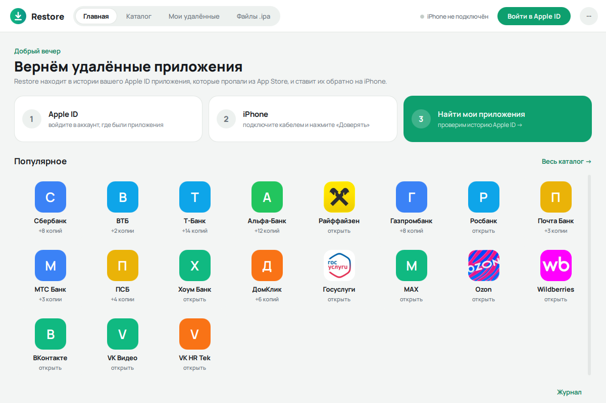
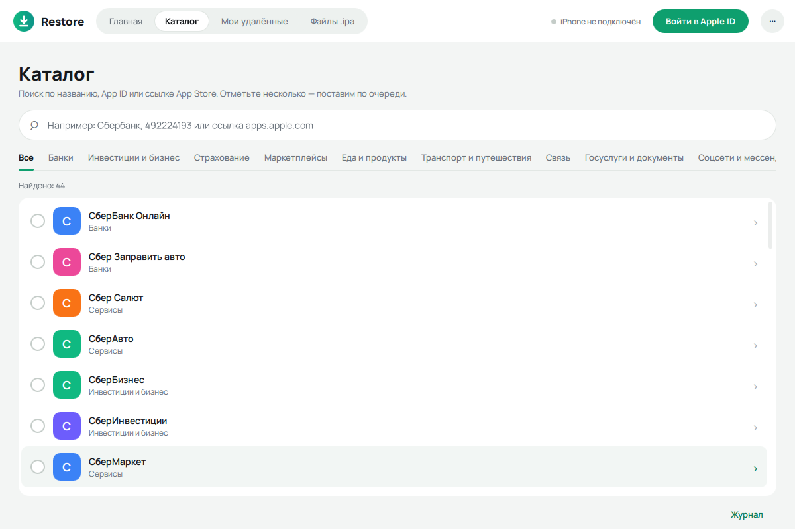
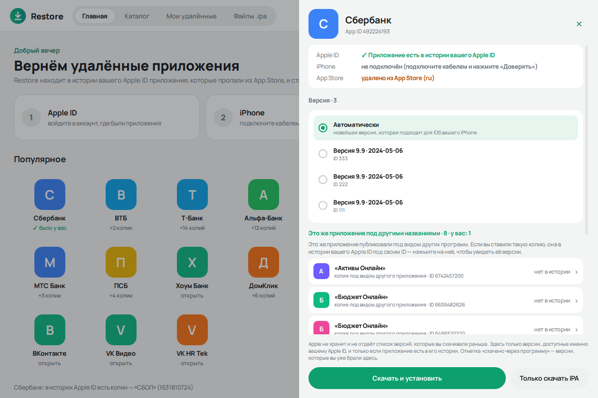
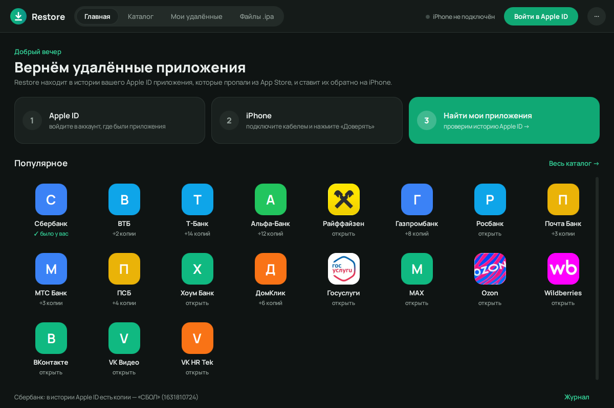
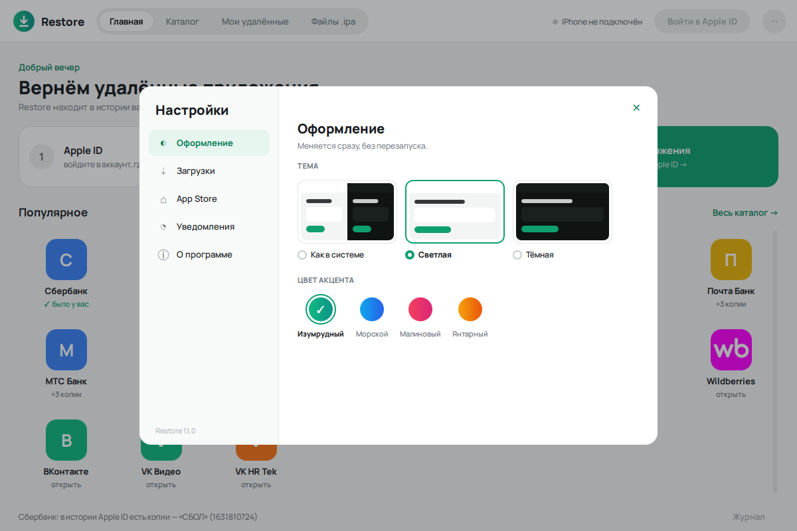

<p align="center">
  
</p>

<h1 align="center">Restore</h1>

<p align="center">
  Возврат на iPhone приложений, которые удалили из российского App Store:<br>
  банки, Госуслуги, маркетплейсы и сотни других. Для Windows.
</p>

<p align="center">
  <a href="../../releases/latest"><b>Скачать установщик</b></a> ·
  <a href="#как-пользоваться">Как пользоваться</a> ·
  <a href="#частые-проблемы">Частые проблемы</a> ·
  <a href="#безопасность-и-данные">Безопасность</a>
</p>



> [!IMPORTANT]
> Restore скачивает приложения с серверов Apple **под вашим Apple ID** и только те, что **уже есть в истории покупок этого аккаунта** — то есть когда-то были у вас установлены. Чужое или никогда не скачанное приложение Apple не отдаст, и программа не пытается это обойти.

## Возможности

- **Всё в одном окне, четыре вкладки вверху:** «Главная» (три шага и популярные приложения), «Каталог», «Мои удалённые» (что нашлось в истории вашего Apple ID) и «Файлы .ipa». Справку, настройки и проверку связи с Apple открывает меню «⋯» справа.
- **Каталог из 700+ удалённых приложений** с поиском по названию, App ID или ссылке App Store, делением на категории и настоящими иконками из App Store (у приложений, которые Apple удалил отовсюду, вместо иконки — буква).
- **Поиск своих приложений:** программа проверяет историю вашего Apple ID и показывает, какие из удалённых приложений у вас были.
- **Копии под другими названиями.** Банки часто публиковали приложение под видом другого (например, «СберБанк Онлайн» как «СБОЛ» или «Умный Онлайн»). В окне приложения видны все его копии, и программа сама проверяет, какие из них есть у вас.
- **Выбор версии.** Список версий, доступных вашему Apple ID, с номерами и датами. Режим «Автоматически» сам подберёт новейшую версию, которая подходит для iOS вашего iPhone.
- **Установка по кабелю** прямо из программы, в том числе нескольких приложений по очереди. Готовый `.ipa` можно поставить и без Apple ID.
- **Светлая и тёмная тема** (или как в Windows) и четыре цвета акцента; в настройках — папка для скачанных `.ipa`, удаление файла после установки, уведомление об окончании долгой операции и проверка обновлений.
- **Понятные ошибки.** Вместо кодов ipatool — объяснение по-русски: DNS «для обхода блокировок», антивирус с проверкой HTTPS, ограничение попыток входа и т. п.

<table>
  <tr>
    <td width="58%"></td>
    <td width="42%"></td>
  </tr>
  <tr>
    <td align="center">Каталог и поиск</td>
    <td align="center">Панель приложения: версии и копии (демо-данные)</td>
  </tr>
  <tr>
    <td width="58%"></td>
    <td width="42%"></td>
  </tr>
  <tr>
    <td align="center">Тёмная тема</td>
    <td align="center">Настройки: тема и цвет акцента</td>
  </tr>
</table>

## Что нужно

- Windows 10 или 11 (64-бит).
- **iTunes** или **«Устройства Apple»** (Apple Devices) из Microsoft Store — это драйвер, без него Windows не видит iPhone.
- iPhone и кабель. Телефон разблокирован, на запрос «Доверять этому компьютеру?» нажмите «Доверять».
- Apple ID, под которым приложение когда-то скачивалось.

## Установка

1. Скачайте `RestoreSetup-<версия>.exe` со страницы [Releases](../../releases/latest).
2. Запустите. Права администратора не нужны: программа ставится в ваш профиль. Если запустить установщик от администратора, можно поставить в Program Files для всех пользователей.

Без установки можно взять `RestoreAppStore.exe` из того же релиза — это та же программа одним файлом. Установленная версия открывается быстрее (меньше секунды против 2–3 с): exe одним файлом при каждом запуске распаковывается во временную папку.

> [!NOTE]
> Программа не подписана сертификатом, поэтому Windows SmartScreen может показать предупреждение «Windows защитила ваш компьютер». Нажмите «Подробнее» → «Выполнить в любом случае». Контрольные суммы файлов — в `SHA256SUMS.txt` релиза.

## Как пользоваться

На «Главной» эти шаги показаны карточками 1-2-3: выполненный шаг отмечается галочкой, а третья карточка — кнопка поиска своих приложений.

1. **Войдите в Apple ID** (кнопка «Войти в Apple ID» вверху справа или первый шаг на главной). Код подтверждения придёт на ваши устройства Apple. Самый первый вход на компьютере может занять до 10–15 минут: ipatool скачивает служебные файлы Apple для подписи запросов.
2. **Подключите iPhone** кабелем и нажмите на телефоне «Доверять» — статус подключения виден вверху.
3. **Найдите приложение:** значки в «Популярном» на главной, поиск во вкладке «Каталог» (по названию, App ID или ссылке apps.apple.com) или шаг **«Найти мои приложения»** — он проверит весь каталог по истории вашего аккаунта (несколько минут), найденное появится во вкладке «Мои удалённые». В каталоге можно отметить несколько приложений кружками и нажать «Поставить выбранные» — они установятся по очереди.
4. **Откройте приложение** — справа выедет его панель. Вверху — есть ли оно в истории вашего Apple ID, подключён ли iPhone и удалено ли из App Store. Если у приложения есть копии под другими названиями, они в отдельном блоке под версиями; нажмите на копию с отметкой «✓ есть у вас», чтобы открыть её версии.
5. **Выберите версию** (или оставьте «Автоматически») и нажмите **«Скачать и установить»**. «Только скачать IPA» сохранит файл, не трогая телефон.

Скачанные `.ipa` хранятся в папке `Документы\Restore\ipa` (у версии без установки — в папке `ipa` рядом с exe) и повторно не скачиваются. Их можно поставить позже на вкладке «Файлы .ipa». Другую папку можно выбрать в «⋯» → «Настройки» → «Загрузки»; там же — удаление файла после установки и кнопка «Очистить…», которая после подтверждения переносит `.ipa` из этой папки в Корзину.

Долгую операцию можно прервать кнопкой «Остановить» внизу окна.

## Частые проблемы

| Что видите | Причина и решение |
|---|---|
| Нет связи с Apple, `no such host`, `i/o timeout` | DNS «для обхода блокировок» (Comss, GeoHide и т. п.) или записи в `hosts` подменяют адреса Apple. Верните автоматический DNS. Пункт **«Проверить связь с Apple»** в меню «⋯» вверху справа проверит все нужные адреса. |
| Ошибка сертификата, `x509` | Антивирус проверяет HTTPS (Касперский, ESET, Dr.Web). Отключите проверку защищённых соединений или добавьте программу в исключения. |
| «Не было у этого Apple ID» | Приложения нет в истории аккаунта. Проверьте копии под другими названиями или войдите под тем Apple ID, которым скачивали. |
| Apple ограничил попытки, `429` | Не повторяйте вход подряд — подождите около часа. |
| iPhone не найден | Нужен iTunes или «Устройства Apple», кабель, разблокированный телефон и «Доверять». |
| Версия не подходит для iOS | Выберите «Автоматически» — программа подберёт версию под ваш iPhone. |

Подробности любой ошибки — в **«Журнале»** (кнопка справа внизу). Если пишете об ошибке, приложите текст оттуда, предварительно убрав свой email.

## Безопасность и данные

- **Пароль Apple ID не сохраняется.** Он передаётся только ipatool для входа. Сессия входа хранится в зашифрованном файле, пароль к которому живёт лишь в памяти программы, и **удаляется при выходе из аккаунта, при закрытии программы и при следующем запуске**.
- **Email Apple ID на диск не записывается**: поле входа каждый раз пустое. Файл `email.txt` прежних версий программа удаляет при запуске, при «Выйти» и при закрытии.
- **Всё служебное — в одной папке `%LOCALAPPDATA%\Restore`:** настройки программы, история скачанных через программу версий, кэш номеров версий и иконки приложений (публичные данные Apple), служебные файлы Apple для входа и эмулятор Unicorn (папка `ipatool`, около 60 МБ). Сессия входа лежит там же, только пока программа открыта. Окно выбора файла не оставляет записей в реестре. Установщик удаляет эту папку при удалении программы.
- Запустить программу дважды нельзя: второй экземпляр стёр бы сессию первого.
- Программа обращается только к серверам Apple (в том числе за иконками приложений) и к GitHub (если ipatool не нашёл встроенный эмулятор Unicorn и по кнопке «Проверить» в «Настройки» → «О программе»). Иконки берутся только с серверов Apple (`*.mzstatic.com`), не больше 2 МБ и только PNG/JPEG; хранятся в `%LOCALAPPDATA%\Restore\icons`.
- В браузере программа открывает только свои ссылки: страницу проекта на GitHub, его релизы и страницу «Поддержать». Названия приложений, ответы ipatool и тексты ошибок показываются как обычный текст, без разметки и ссылок.
- Удаляет программа только свои служебные папки и, по вашему подтверждению, `.ipa`-файлы (в Корзину). Внешние программы запускаются без командной оболочки.
- Ограничение ipatool: пароль передаётся ему аргументом командной строки, поэтому на время входа он виден другим программам под вашей учётной записью.
- **Скачанные `.ipa` содержат ваш Apple ID и имя** (`iTunesMetadata.plist`) и привязаны к вашему аккаунту. Не выкладывайте их в открытый доступ.

## Запуск из исходников

Нужен Python 3.12 и [ipatool](https://github.com/majd/ipatool/releases): для окна — в `PATH` или рядом со скриптами, для консольной версии — в `PATH`.

```bash
py -V:3.12 -m pip install PySide6 pymobiledevice3 segno
```

```bash
py -V:3.12 restore_apps_gui.py
```

Есть и консольная версия:

```bash
python restore_apps.py search сбер
```

```bash
python restore_apps.py restore 492224193
```

Тесты логики (без сети, Apple ID и iPhone):

```bash
py -V:3.12 -m unittest discover tests
```

## Устройство кода

| Файл | Что внутри |
|---|---|
| `restore_apps.py` | ядро и консольная версия: каталог, пути, запуск ipatool |
| `restore_apps_gui.py` | запуск оконной версии |
| `restore_gui/qml/` | интерфейс на Qt Quick: главное окно, верхняя панель с вкладками, страницы, панель приложения, диалоги, окно настроек |
| `restore_gui/fonts/` | шрифт интерфейса Manrope (SIL OFL 1.1) |
| `restore_gui/backend.py` | всё, что видит окно: состояние, списки, действия кнопок |
| `restore_gui/detail.py` | панель приложения: история Apple ID, копии под другими названиями, версии |
| `restore_gui/tasks.py` | долгие операции в фоне: вход, поиск по каталогу, скачивание, установка |
| `restore_gui/app.py`, `models.py`, `icons.py` | запуск окна; списки для QML; иконки из App Store |
| `restore_gui/catalog.py` | категории, семьи копий, поиск — без интерфейса |
| `restore_gui/apple.py` | ipatool и сервера Apple: разбор ответов, объяснения ошибок |
| `restore_gui/device.py`, `storage.py`, `theme.py`, `prefs.py` | iPhone и .ipa; служебные файлы; палитры; настройки |
| `installer/` | установщик Inno Setup; `make_art.py` рисует иконку и картинки мастера |
| `tests/` | тесты логики |

## Каталог

Список удалённых приложений — `removed_ru_appstore_app_ids.csv` (`app_id,name,category,src`). Копия, которую публиковали под чужим названием, записывается как «Бренд (Другое имя)»: так она попадает в «семью» оригинала и находится в поиске.

## Сборка

```bash
powershell -ExecutionPolicy Bypass -File build.ps1
```

Скрипт создаёт окружение `build\venv` (Python 3.12, версии из `requirements-build.txt`), скачивает ipatool 2.7.0 и Unicorn 2.1.4 из официальных релизов **со сверкой SHA-256** и прогоняет тесты. Затем собирает (PyInstaller):
- `dist\RestoreAppStore.exe` — портативная версия одним файлом;
- `dist\RestoreAppStore\` — та же программа папкой, для установщика;

а также установщик `dist\RestoreSetup-<версия>.exe` ([Inno Setup 6](https://jrsoftware.org/isinfo.php)) и `dist\SHA256SUMS.txt`. Флаг `-SkipInstaller` собирает только exe.

Из Qt в сборку попадает только то, что нужно интерфейсу (список исключений — `DROP` в `RestoreAppStore.spec`). После сборки оба exe запускаются с ключом `--check-ui`: интерфейс загружается без показа окна, и если из Qt вырезано что-то нужное, сборка останавливается.

Версия программы задаётся в `restore_apps.py` (`__version__`).

## Поддержать разработчика

Restore бесплатная. Если она помогла вернуть нужное приложение, можно поблагодарить через [CloudTips](https://pay.cloudtips.ru/p/d4214684) — та же ссылка есть в программе («♡ Поддержать» вверху справа и в «Настройки» → «О программе»).

## Лицензия

[GPL-3.0](LICENSE). Программа включает компоненты под GPL (pymobiledevice3, Unicorn), LGPL-3.0 (Qt / PySide6), MIT (ipatool) и другие — см. [THIRD_PARTY_NOTICES.md](THIRD_PARTY_NOTICES.md).

Проект не связан с Apple. App Store, iPhone и iOS — товарные знаки Apple Inc. Используйте программу только для приложений из истории покупок своего Apple ID.
